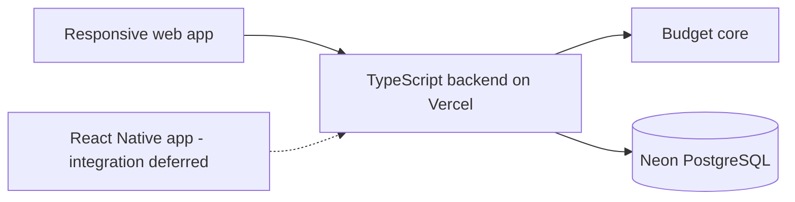
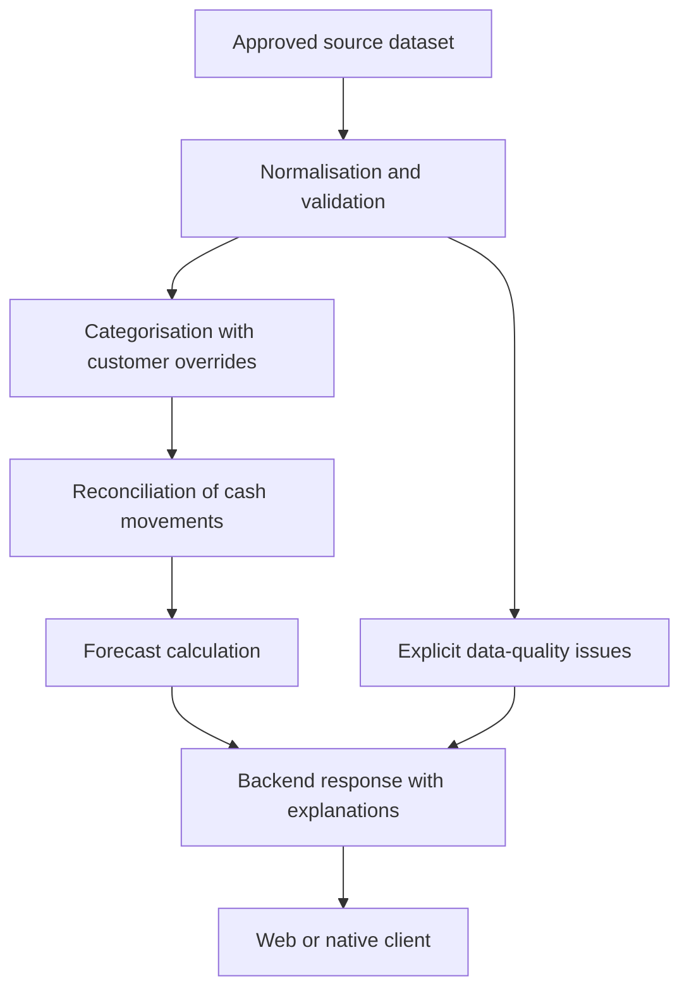

# Architecture

Status: modular monolith with feature-based layers and ports/adapters at banking and persistence boundaries. Accounts, transactions, planned payments and budget create/edit APIs are implemented, with shared schemas and deterministic normalization/allocation logic. Default local/test runtime is memory; PostgreSQL is explicit opt-in. No shared migrations or deployment were performed.

## Goals and scope

Deliver a React Native / Expo application first, with a responsive web client deferred. Both will use the same backend contracts. Keep UI presentation, application workflows, financial calculations and persistence independently understandable and testable.

Use [requirements](docs/requirements.md), [user stories](docs/user-stories.md) and the [domain model](domain-model-notes.md) as the behavioural baseline. The previous bachelor-project repository is not a source of current requirements.

## System boundaries

- `apps/web`: React, TypeScript and Vite; one responsive application for desktop and mobile browsers.
- `apps/backend`: TypeScript HTTP backend intended for Vercel. It validates requests, enforces access, coordinates workflows and performs authoritative calculations.
- `apps/mobile`: React Native / Expo client with native screens and navigation; API integration deferred.
- `packages/budget-core`: framework-independent calculation and data-processing logic.
- `packages/contracts`: shared API request/response types and runtime validation schemas.
- `database/migrations`: version-controlled PostgreSQL schema changes.
- Neon supplies PostgreSQL persistence. It is not the application's HTTP backend.



Both clients communicate with the backend API. Neither client connects directly to Neon. Only server-side configuration contains database credentials. Code sharing does not imply shared web and native UI components.

## Web application structure

```text
apps/web/src/
  app/
  foundation/
    components/
    styles/
  features/
    budget/
      components/
      containers/
      hooks/
      api/
      index.ts
    transactions/
    forecast/
  lib/
```

| Area | Responsibility | Must not own |
| --- | --- | --- |
| app | Application startup, routes, providers and composition of feature screens | Financial rules or database access |
| foundation/components | Reusable presentation primitives such as Button, Input, Card and Dialog | Budget knowledge, feature imports or business API calls |
| foundation/styles | Shared colours, typography, spacing and global styles | Feature-specific behaviour |
| features/*/components | Feature-specific presentation with explicit props and callbacks | Fetching and persistence mixed into display components |
| features/*/containers | Coordinate screen data, state, loading, errors and user actions | Financial algorithms or direct database access |
| features/*/hooks | Reusable feature state and orchestration where useful | An unnecessary wrapper for every component |
| features/*/api | Feature-specific backend requests and response handling | UI rendering or server credentials |
| lib | Technical utilities such as the shared HTTP client | Unrelated business logic collected in a global helper folder |

### Component rules

1. Foundation components are domain-agnostic. A Button does not know what a budget is. They receive props and report interactions through callbacks.
2. Local UI state is allowed in foundation components, for example whether a dropdown is open. Business state and network requests remain outside them.
3. Feature components follow single responsibility. BudgetSummary renders a summary; BudgetSetupContainer coordinates setup inputs, requests and feedback.
4. Keep feature-specific components inside their feature even when several screens use them. Promote code to foundation only when it is genuinely general-purpose.
5. Keep state close to its owner. Use app-level providers only for genuinely cross-cutting concerns, rather than putting all feature state in a global store.
6. A feature's index.ts exposes a small public interface. Other features must not import its internal files. Avoid circular dependencies; compose workflows in app when appropriate.
7. Add containers, hooks and api files only where they simplify an actual responsibility. Do not split a small component solely to match the directory tree.
8. Put tests beside the component or module they cover. Include keyboard, labels, loading, empty and error states where relevant.

### Dependency direction

App composes features. Features may depend on foundation, lib and contracts. Foundation never imports features, backend code or database code. Lib does not import features. Contracts must remain usable by both web and native clients and by the backend.

The web may format money and validate form input, but the backend validates requests again and calculates authoritative financial results. Do not duplicate forecasting algorithms in UI components.

## Backend structure

```text
apps/backend/src/
  features/
    budgets/
    transactions/
    forecasts/
  infrastructure/
  shared/
```

Within each backend feature, introduce these responsibilities as needed:

- Routes: HTTP request parsing, boundary validation, authentication context and response/status mapping.
- Services: application workflows, access checks, coordination of repositories and budget-core, and transaction boundaries.
- Repositories: queries and persistence mapping. They do not render UI or calculate forecasts.
- Infrastructure: database connection configuration and external integration adapters.
- Shared: genuinely shared error handling, request helpers and cross-cutting server utilities.

Routes call services; services call repositories and budget-core. Repository implementations use the infrastructure database connection. Budget-core must not depend on routes, repositories, React, Vercel or Neon. Shared backend code must not become a dependency cycle between features.

Derive the customer identity from the authenticated server context, never trust a customer ID supplied by a client as proof of ownership. All account and budget operations must enforce the corresponding access rules. Authentication technology is still an open implementation decision; it must be resolved before a shared deployment exposes customer-scoped data.

## Shared packages

### budget-core

Keep normalisation, categorisation, reconciliation and forecasting deterministic where possible. Pass input data and the calculation date explicitly. Use integer oere or exact decimal arithmetic. Return explicit data-quality issues rather than silently interpreting missing values as zero.

Keep budget plans distinct from forecast estimates. Quarterly and annual bills have both monthly planning equivalents and dated cash movements; do not count both as cash outflows. Virtual allocations and rollover between subaccounts must not inflate income or spending or alter the account balance. Actual bank transfers are separate recorded movements. Review the existing local budget-core experiment against current requirements before migration.

### contracts

Share request/response types, runtime validation schemas and documented error formats. Keep database drivers, persistence entities, UI frameworks and secrets out of this package. TypeScript types alone do not validate untrusted runtime input. Convert persistence records and calculation results to explicit API responses at the backend boundary.

## Data flow



The diagram shows logical processing stages, not separate deployed services. Imported source records and customer overrides remain distinguishable so re-imports do not silently erase corrections. Mark invalid or uncertain records for review; do not silently discard them or invent replacement values. Reconcile booked transactions, pending movements and planned payments before combining them in a forecast.

Budget creation must require exactly one account, validate ownership and enforce the one-budget-per-account rule atomically, including concurrent requests. The database schema and transaction strategy must support this rule; disabling a checkbox in the frontend is insufficient.

Use dated forecasts with their input period and material assumptions. A successful budget save and an unavailable forecast are distinct outcomes; the response and UI should represent them separately.

## Domain responsibilities

The simplified model describes concepts, not persistence entities or API payloads. Each budget uses exactly one user-owned account, divided into named virtual SavingsSubaccount, SpendingSubaccount and FixedExpenseSubaccount pots. Categories and bill schedules remain supporting details rather than additional bank accounts.

- Budget stores the monthly take-home salary. Subaccount allocations are non-negative and their total cannot exceed it. Savings accumulate; fixed-expense pots reserve money for bills.
- Transactions belong to the account and may be assigned to at most one pot. Imported data and customer assignment overrides remain distinguishable. Unassigned or uncertain transactions stay visible.
- Budget-core calculates remaining monthly spending, weekly/daily guidance and rollover amounts using explicit periods and exact money. Remaining spending includes carried-in money. A forecast remains a separate estimate and must not treat an allocation or rollover as a cash outflow.
- The backend saves each spending pot’s optional rollover preference and automation-enabled state (off until chosen), and validates any savings target against ownership, type and the same account. Clients offer setup opt-in and later changes through the API.
- At month-end, a service applies positive leftovers automatically only when enabled. Otherwise it exposes a pending decision in the monthly summary. Deferred money stays out of new allowances until confirmed; record the closed source month and actual destination period when a later decision is applied. A database transaction must make the rollover record and virtual amount updates atomic, with uniqueness per source spending pot and closed month. Retries must not allocate money twice.
- Preserve monthly results and the actual source/destination of completed rollovers. Changing preferences or allocations must not rewrite closed history. The simplified diagram omits the persistence details needed for this history.
- Missing inputs or an invalid destination leave rollover unresolved with a visible reason. Do not silently redirect it or infer zero. The rollover workflow does not execute payments.

Before implementing month closure, specify the budget timezone/cutoff, the trigger and retry mechanism, and handling of late transactions or corrections. These operational details are not determined by the conceptual diagram.

## Persistence and deployment

Store schema changes under database/migrations and select a migration tool before creating executable migrations. Keep migration history and synthetic fixtures separate. Do not commit database credentials, raw banking datasets or database dumps.

The agreed hosting direction is Vercel for the backend and Neon for PostgreSQL. Neon is provisioned with production and development branches in Frankfurt. The backend uses npm workspaces, Express and Drizzle with the Neon HTTP driver. The local connection is stored in an ignored apps/backend/.env file. A domain migration is generated but not applied; deployment is not implemented. Before deployment, document database connection management, regions, secrets, access control and permitted data use. Confirm approval before uploading the supplied bank dataset to cloud services.

No production banking connection or payment execution is in the initial scope.

## Verification

- Unit tests: salary-allocation totals, monthly/weekly allowances, rollover amounts, normalisation, classification overrides and reconciliation edge cases.
- Component tests: observable UI behaviour, including accessibility and uncertainty states.
- Backend integration tests: request validation, account ownership, same-account savings targets, monthly history, atomic rollover retries/concurrency and errors using an isolated test database.
- End-to-end tests: create and reopen a budget, review corrections and interpret forecast availability.
- Usability and forecast evaluation: follow the delivery plan; passing automated tests is not evidence of forecast accuracy or user understanding.

Use stable FR, NFR and US identifiers to connect tests and implementation with the requirements. Do not claim build/test commands exist until their workspace configuration is committed.

## Next implementation decisions

1. Authentication and domain API error conventions. Express is selected for HTTP; the initial 404 format is { error: { code, message } }.
2. Additional workspace and lint tooling as web/shared packages are initialised; backend commands are documented in apps/backend/README.md.
3. PostgreSQL schema, migration tool and test-database setup.
4. Forecast balance basis, minimum historical coverage and uncertain payment handling.
5. Deployment environments and approved use of the supplied dataset.
6. Month-close timezone, cutoff, trigger/retries and late-transaction correction policy for US-12.
7. Effective dates for allocation changes and how reserved fixed-expense amounts evolve after bill payments; retain closed monthly results.

Keep AGENTS.md commands aligned with the implemented workspace workflow. Update this document when a decision changes rather than letting implementation and documentation diverge.

## Implemented foundation decisions — 9 November 2026

The application factory injects identity, bank provider, budget repository and clock. Bank source and budget storage are independent. JSON data is normalized once and cached; only the bank adapter reads the raw file. The bank-provider port supports account listing and owner/account-scoped snapshots. Memory tests make no external requests.

The current plan is an atomic budget aggregate with income rows, ordered typed pot rows, color tokens and optional source explanations. Salary is derived from income rows, and monthly allocations from pot rows. Savings is never automatically redistributed; the client explicitly submits an accepted change. Client totals and owner IDs are rejected. Existing account assignment is immutable. Schema limits prevent oversized requests, not arbitrary Figma demo limits.

PostgreSQL persists indexed identity/owner/account fields, revision/timestamps and a validated JSONB plan. A unique account constraint and revision-conditioned update protect concurrent writes. Public API responses omit owner IDs and database internals. Normalization exposes unknown amounts/directions and actual coverage. An initial suggestion must not rerun during edits; AI, savings-goal recommendations and forecasts remain unimplemented.

The current plan is not historical accounting. Closed months, allocation effective dates and month-close policy must be implemented separately before execution; current-plan updates cannot be represented as preserved monthly history. See [backend foundation story](docs/backend-foundation-story.md) and [API specification](docs/openapi.json).

## Native mobile shell — first frontend delivery

`apps/mobile` uses Expo SDK 58, React Native, TypeScript, Expo Router and StyleSheet. `src/app` owns thin routes and font/safe-area startup. `foundation/components` contains Screen, AppText, BankHeader, Button and Card; `foundation/theme` owns colors, typography and spacing. Budget introduction belongs to `features/budget/screens`; demo screens and the navigation bar belong to `features/shell`.

Foundation has no budget knowledge, requests or global business state. Screen layouts scroll and avoid fixed text heights. Fonts are local licensed assets. Four tabs open on Budget; Create budget is deliberately disabled. No API client, repository or state library is added before a concrete workflow needs one. Native UI components are not shared with the future web UI.

Native Jest/Expo tests run separately from the backend Node runner. Root dev dependencies pin shared React/native test peers to the SDK-compatible versions so npm does not hoist newer incompatible peers into Expo Router. Backend runtime and its memory default are unchanged.

## Demo profile and account data

The users feature exposes GET /api/v1/me through a route and service. Its bank-provider port supports owner-scoped profile lookup alongside account reads. The local JSON adapter caches a profile and normalized dataset from one source load; its owner is explicitly configured as the trusted demo identity. Source names and transaction account strings cannot authenticate or create users. This read-only source needs no new user repository or database migration.

A configured file failure maps to safe HTTP 503 BANK_DATA_UNAVAILABLE and remains cached until restart; it never switches to the fixture. Unknown display names are null. Future authenticated adapters must supply truthful profile provenance and the trusted owner association. Local demo identity remains forbidden in deployed environments.

## Native account selection

The Budget tab contains a nested stack for introduction and account selection. The feature screen owns request/selection state; AccountOption receives presentation props. A small `lib/api` client handles cancellation, timeout and safe transport errors. The feature API validates /me, /accounts and /budgets against shared contracts before returning selection data. No global store or financial calculations are added. Selection is transient; persistence remains a future slice.

Physical phones use an explicit public API URL and the opt-in backend LAN command. Loopback remains the default. Existing API contracts and server-side exclusivity checks remain authoritative; disabling an account in the app does not replace atomic checks when budget creation is implemented.
