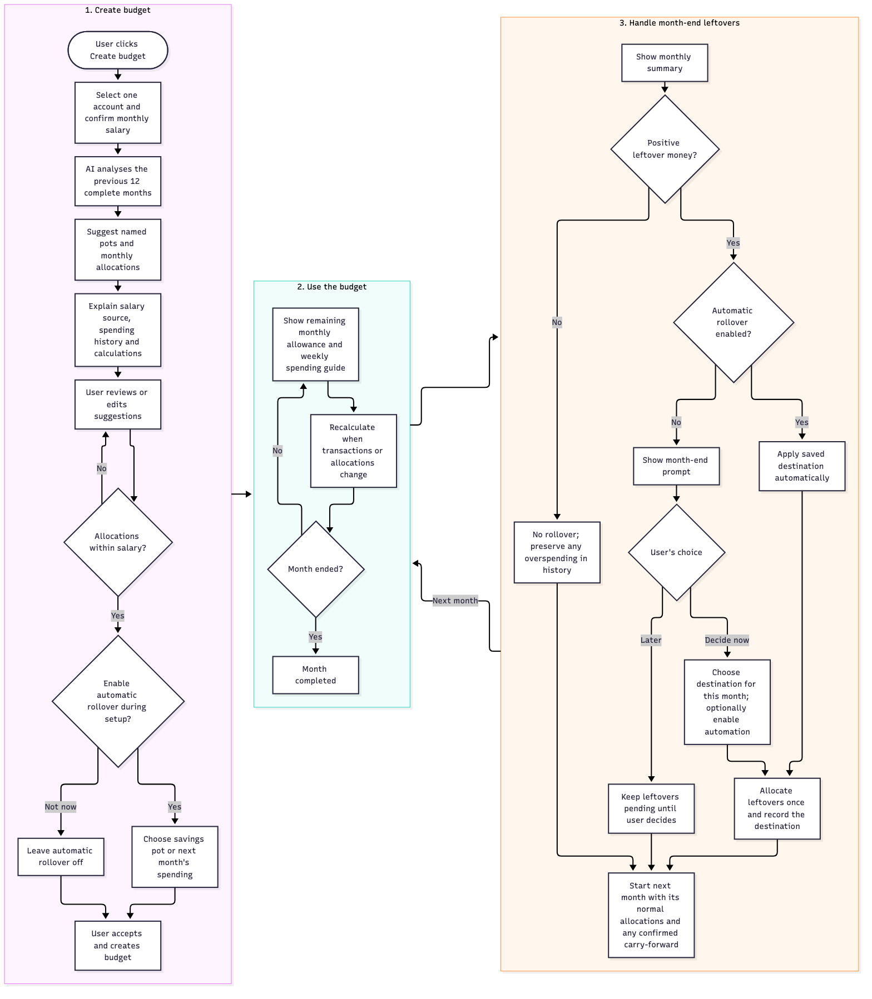

# Budget creation and monthly rollover

This activity diagram describes the proposed customer flow. It complements the [domain model](../domain-model-notes.md); it does not describe implemented functionality.

[Mermaid source](budget-creation-flow.mmd) · [Full-size image](budget-creation-flow.png)

## Rules

- The selected account provides transaction history; the customer confirms monthly take-home salary. AI suggests named spending, fixed-expense and savings pots and explains the history and calculations behind each amount.
- Use the previous 12 complete months where available. Exclude salary and transfers from spending, and count irregular bills only once. Suggest savings from salary remaining after suggested spending and fixed expenses. Limited history is disclosed; no usable history leads to manual allocation, not invented amounts.
- Suggestions populate four expandable widgets: Monthly salary (income), Spending budget, Fixed expenses and Savings. Inline rows contain editable text and DKK amounts with up to two decimal places; read-only totals recalculate from rows. Customers can add/remove rows, add named pots and choose accessible widget colors.
- Suggestions are editable drafts. Over-allocation blocks creation; positive unallocated income is allowed. After the initial suggestion, savings changes only through direct edits or an explicitly confirmed Update savings review. The budget is saved only when the customer accepts.
- Editing follows overview → confirm the fixed existing account → edit saved widgets → Save changes. Never rerun initial AI suggestions. Cancel preserves the saved plan; save errors retain inputs and revision conflicts cannot silently overwrite newer edits.
- After creation, Save for an item offers a labelled sample allocation proposal with Apply plan/Cancel. It is unavailable during setup; recommendation rules and goal persistence remain deferred.
- Automatic rollover is optional for each spending pot during setup and is off until the customer enables it. Enabling it requires choosing savings in the same account or the same spending pot next month. The setting can be changed later.
- At month-end, positive leftovers follow the saved preference only when automation is enabled. Otherwise, show a prompt in the monthly summary. The customer chooses this month's destination and may enable the same choice for future months.
- If the customer postpones the prompt, keep that month's leftovers pending and visible in history. The next month starts normally; pending money is not silently added to savings or its spending allowance. A later decision applies the amount once to the chosen savings pot or as carried-in spending in the then-current month and records both the closed source month and the destination period.
- No positive remainder means no rollover. Preserve any overspending in history. The summary can still offer automatic-rollover settings for future months.
- Weekly and monthly allowances update as recorded transactions or allocations change. They are budget guidance, not enforced card limits or a guarantee that live banking data is instantaneous.
- Every allocation is virtual: the bank balance stays unchanged. Record each completed rollover once per source pot and closed month, including its actual destination.

## Review scenarios

- Enable savings rollover at setup: positive leftovers move automatically; no monthly confirmation is required.
- Skip automation: a positive remainder produces a month-end prompt; choosing once does not enable future automation unless requested.
- Choose next month's spending: a DKK 500 leftover adds to a DKK 8,000 allocation, giving DKK 8,500 before new spending.
- Postpone the prompt: the next month starts without using pending money; the unresolved month remains available for later action.
- Zero or negative remainder: no money is allocated; overspending remains visible.
- Missing savings target, incomplete amounts or repeated processing: no invalid or duplicate rollover is applied.

Requirements: FR-01–04, FR-07–10. Stories: US-03, US-04, US-06, US-10–12. This revision makes setup automation optional and adds the month-end fallback prompt.

The diagram is a high-level creation/month-end overview; detailed widget, edit and item-goal acceptance criteria live in [US-04, US-13 and US-14](user-stories.md). It is not a claim that those flows are implemented.
