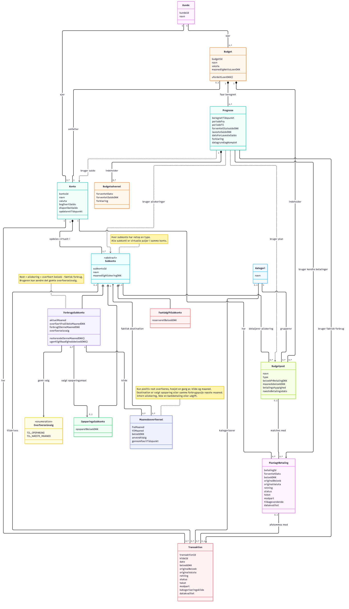

# Domain model publication status

This is the conceptual model requested on 5 November 2026, not an implemented database schema or completed feature. The supplied Danish diagram and accompanying notes are preserved as design artifacts.

The latest design specifies exactly one bank account per budget, virtual savings/spending/fixed-expense pots, and a saved month-end rollover preference. This narrows the earlier one-or-more-accounts baseline in FR-01 / US-03. Weekly spending guidance supplements the daily guidance in US-06. The existing requirements and acceptance criteria have not been rewritten by this publication; implementation must reconcile them explicitly with these design decisions. Rollover is proposed behaviour, not a completed user story.

The source dataset mentioned below is not included in this repository or this commit. No application code, real financial records, or credentials are part of this publication.

---

# Domænemodel for Danske Bank Budget Builder

Mermaid-kilden findes i `domain-model.mmd`. Modellen er et konceptuelt klassediagram over den aftalte løsning, ikke et databaseskema eller en beskrivelse af allerede implementeret funktionalitet.

## Aftalte regler

- En kunde kan have flere separate budgetter, som bruges samtidig.
- Et oprettet budget omfatter præcis én konto. En konto kan være uden budget eller tilhøre ét budget ad gangen. Konto og budget skal tilhøre samme kunde. Kladder og fælleskonti er ikke modelleret.
- Kontoen opdeles i mindst én navngiven virtuel subkonto. Hver subkonto har præcis én type: opsparing, forbrug eller fast udgift. Puljerne repræsenterer fordeling af kontoens penge, ikke separate bankkonti.
- Budgettet angiver månedlig nettoløn. Brugeren fordeler den mellem subkonti; summen af månedlige allokeringer må ikke overstige lønnen. Ufordelt løn er nettoløn minus allokeringerne. Opsparing tilføres sin allokering og bevares på tværs af måneder; faste udgifter reserverer deres allokering til regninger.
- Et budget er løbende; beløb planlægges månedligt. Hver prognose har en konkret periode frem til månedens afslutning.
- En budgetpost har én kategori. Flere poster kan have samme kategori, fx flere abonnementer. Sammenligningen med faktiske transaktioner sker samlet pr. kategori, så samme transaktion ikke tælles for hver post.
- Budgetpostens type er indtægt, fast udgift, variabel udgift eller opsparing. Opsparing er en planlagt overførsel/allokering og skal holdes adskilt fra forbrug.
- Betalingsbeløb, betalingshyppighed og næste betalingsdato bruges for tilbagevendende poster. Variable forbrugsrammer kan nøjes med et månedsbeløb. Månedsbeløbet er afledt for årlige og kvartalsvise poster; en årlig regning på 12.000 kr. giver 1.000 kr. pr. måned, men den fulde betaling påvirker saldoen på betalingsdatoen.
- Transaktioner kategoriseres automatisk. Kundens rettelse har forrang; kategoriseringskilden viser automatisk eller manuel. En transaktion kan være ukategoriseret.
- Prognosen viser forventet slutsaldo, opdager negativ saldo undervejs og forklarer resultatet kort. En budgetadvarsel knyttes til den prognose, der har frembragt den.

## Forbrug og månedsskifte

- Resterende månedsforbrug = månedlig allokering + overført beløb fra sidste måned − faktisk forbrug denne måned. Faktisk forbrug udledes af tilskrevne transaktioner og er ikke en ekstra udgift i prognosen.
- Ugens rådighedsbeløb beregnes som positiv rest divideret med resterende kalenderdage inklusive i dag, ganget med det mindste af 7 og resterende kalenderdage. Negativ rest vises som overforbrug og giver et rådighedsbeløb på nul.
- Hver forbrugssubkonto har et gemt valg, som brugeren kan ændre: `TIL_OPSPARING` eller `TIL_NAESTE_MAANED`. Valget ved månedens afslutning anvendes automatisk.
- `TIL_OPSPARING` kræver en valgt opsparingssubkonto i samme konto. `TIL_NAESTE_MAANED` lægger resten oven i næste måneds normale allokering i samme forbrugssubkonto.
- Kun en positiv rest overføres. Der registreres højst én månedsoverførsel pr. forbrugssubkonto og afsluttet måned, så en gentaget behandling ikke flytter beløbet igen. Nul eller negativ rest giver ingen overførsel; overforbrug bevares i den afsluttede måneds resultat.
- Månedsoverførslen gemmer beløb, kilde, faktisk destination, fra- og tilmåned, anvendt valg og gennemførelsestidspunkt. Senere ændringer af brugerens valg må ikke ændre historikken. Den afsluttede måneds beregningsgrundlag bevares ved månedsskifte.
- En månedsoverførsel ændrer den virtuelle fordeling, ikke kontoens samlede saldo. Den er hverken ny indkomst, forbrug eller en rigtig bankbetaling.
- Budgetposter kan detaljere en subkontos allokering, fx flere regninger i en fast-udgiftspulje. Allokeringen og dens underliggende poster må ikke tælles som to separate udgifter. En transaktion kan tilskrives højst én subkonto og kan være ufordelt, indtil den er identificeret.

## Kobling til demo-data

Den lokale fil `budget-builder-demo-data.json` indeholder én konto, 83 transaktionsposter og 14 betalingsposter.

| Data i filen | Domænebegreb | Bemærkning |
|---|---|---|
| `account` | Konto | Navn, valuta, saldi og opdateringstidspunkt |
| `account.ownerName` | Kundens navn | Kundeidentitet og ejerskab er en udvidelse; filen har ikke et selvstændigt kundeobjekt |
| `transactions.items` | Transaktion | Faktiske eller afventende/reserverede posteringer; status afgør behandling |
| `payments.items` | PlanlagtBetaling | Kendte betalinger med dato og status; filen omfatter også en lønpost |
| Ingen direkte struktur | Budget, Budgetpost, Kategori | Tilføjes ud fra de aftalte produktregler |
| Ingen direkte struktur | Prognose, Budgetadvarsel | Beregnede domæneresultater |

PlanlagtBetaling er en kendt, dateret ind- eller udbetaling. En budgetpost er kundens plan eller forbrugsramme. Et tilbagevendende flag alene angiver ikke betalingshyppighed; den skal bekræftes eller udledes særskilt.

En planlagt betaling kan matches til én budgetpost og senere afstemmes med én transaktion. Det er en forenkling for prototypen; delbetalinger og samlebetalinger er ikke omfattet. Matches findes ikke eksplicit i demofilen og skal derfor etableres med tilstrækkeligt sikre oplysninger.

## Regler for et troværdigt beregningsgrundlag

- Modellen viser normaliserede beløb og datoer. Filen indeholder blandede datatyper, forskellige datoformater, ukendte værdier, varierende statusnavne og et gentaget transaktions-ID. Et internt transaktions-ID skal være unikt; kilde-ID alene er ikke en sikker identitet eller deduplikeringsnøgle.
- DKK-beløb må kun beregnes ud fra et pålideligt beløb i kontovaluta eller en anvendelig valutakurs. Ukendte beløb, datoer og retninger må ikke gættes eller behandles som nul. Datakvalitet angiver, om posten kan indgå; prognosen viser, hvis grundlaget er ufuldstændigt.
- Aflyste betalinger indgår ikke i forventede betalinger. Ukendte og afventende statusser kræver en særskilt, dokumenteret behandling.
- Samme økonomiske hændelse må kun påvirke prognosen én gang: en kendt betaling erstatter det tilsvarende forventede beløb fra budgetposten, og en afstemt transaktion erstatter den planlagte betaling.
- Prognosen skal anvende et fælles saldotidspunkt og en entydig behandling af reservationer. Historiske transaktioner bruges til forbrug og mønstre og må ikke trækkes fra en aktuel saldo igen.
- Overførsler mellem virtuelle subkonti er hverken indkomst eller forbrug for det samlede budget. Overførsler mellem separate budgetters bankkonti påvirker hvert budgets likviditet, men skal stadig identificeres som overførsler.
- Kontoens skift mellem budgetter er ikke historiseret i denne model. Hvis historiske budgetresultater skal bevares ved flytning af konti, skal datomodellen udvides med gyldighedsperioder eller snapshots.

API-felter som pagination, `isSuccess`, `errorMessage`, `meta`, journal- og versionsoplysninger er transportmetadata og er derfor udeladt af domænediagrammet. Kontonumre og konkrete personoplysninger fra filen er ikke kopieret ind i diagrammet.

Den aftalte prognosefunktion er smallere end hele PRD'ens ønskeliste. Kategorioverskridelser, usædvanligt forbrug og øvrige indsigter er mulige senere udvidelser. Modellen tilføjer hverken en chatbot eller betalingsfunktionalitet.
